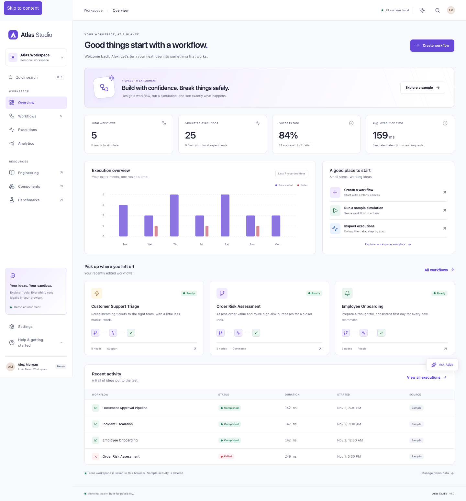
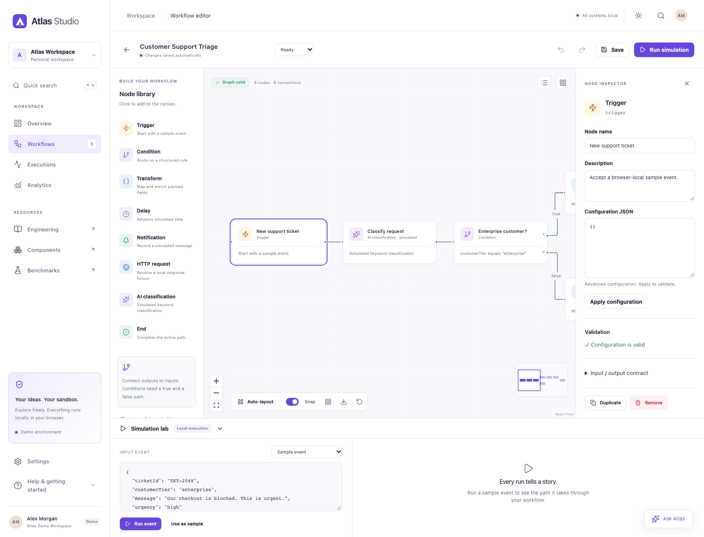

# Atlas Studio

**Design workflows. Simulate outcomes. Understand every step.**

Atlas Studio is a browser-local visual workflow environment. Create a graph, run a sample event through real condition and transformation logic, and inspect the resulting execution step by step. No backend, signup, database server, external APIs, or API keys are required.

The intended public address is **https://atlas.axvrma.com**. Hosting and DNS have **not** been configured by this implementation. The repository target is https://github.com/axvrma/atlas; no remote repository was created or pushed.

## Product screenshots

Actual browser captures from the production artifact:




Additional desktop/mobile screenshots are retained in Playwright report attachments. These are real captures, not fabricated product images.

## Features

- Marketing site with an engine-backed workflow preview, product narrative, engineering pages, SEO metadata, sitemap, favicon, and social image.
- Isolated Alex Morgan demo workspace with interactive, restartable guided tour and no authentication.
- Five coherent seeded workflows: support triage, order risk, onboarding, incident escalation, and document approval.
- Workflow library with search, status filters, sorting, grid/list views, creation, duplication, rename, confirmed deletion, and last-run links.
- XYFlow editor with draggable nodes, connections, selection/multiselection, pan/zoom/fit, minimap, snap, auto-layout, keyboard shortcuts, bounded undo/redo, copy/paste, configuration inspector, validation, autosave, and an accessible node/connection list.
- Eight node kinds: trigger, condition, transform, delay, notification, mock HTTP, simulated AI classification, and end.
- Deterministic execution, true/false routing, payload propagation, virtual time, structured logs, retries, cancellation, failure handling, and skipped paths.
- Configurable JSON inputs, alternate-branch/failure scenarios, execution history, debugger playback/speed/step controls, input/output/log inspection, payload copy, run replay, and outcome comparison.
- Analytics derived from stored execution records, with workflow/source/date filters and explicit seeded/local labels.
- IndexedDB persistence, versioned migration, localStorage/in-memory failure recovery, JSON import/export, reset, and persisted light/dark/system themes.
- Atlas Copilot — Simulation Mode: named workflow templates, graph explanations, validation guidance, failure explanations, and honest unsupported-intent responses. No language model is used.
- Independent Storybook app consuming the shared UI package at `/storybook/`.
- Engineering documentation, architecture decisions, reproducible benchmarks, static deployment assembly, and CI quality gates.

## Stack and architecture

React 19, strict TypeScript, Vite 7, React Router, XYFlow 12, Dagre, Radix UI primitives, Zod, idb, Vitest/Testing Library, Playwright/axe, pnpm workspaces, and Turborepo. Versions are locked in `pnpm-lock.yaml`. Node 22.22.0 satisfies the verified Vite and Storybook runtime requirements. The compatible Vite 7 line avoids an unnecessary bundler migration while Storybook supports it.

```text
atlas/
├── apps/
│   ├── web/src/          # Routes, editor, product pages, storage, providers
│   └── storybook/        # Independent configuration and eight story categories
├── packages/
│   ├── contracts/src/    # Zod schemas and domain types
│   ├── core/src/         # React-free engine, validation, mock copilot
│   ├── mock-data/src/    # Five seeded graphs and engine-generated executions
│   ├── ui/src/           # Shared accessible React components
│   ├── tokens/src/       # Semantic light/dark CSS tokens
│   └── config/           # Shared strict TypeScript configuration
├── tests/e2e/            # Production-artifact browser journeys and axe checks
├── scripts/              # Benchmark, build assembly, static preview
├── docs/                 # Architecture, ADRs, accessibility, deployment, captures
├── infra/                # Infrastructure scope
├── .github/              # Validation workflow and dependency updates
└── netlify.toml          # One site; app + /storybook/ with scoped fallbacks
```

The engine depends only on contracts. UI components are shared by web and Storybook. Historical runs embed graph snapshots. The editor's graph history is separate from persisted execution history. See [architecture](docs/architecture/overview.md) and [ADRs](docs/adr/001-workspace-and-build.md).

## Local development

```sh
# Use Node 22.22.0, e.g. nvm use
corepack enable
pnpm install --frozen-lockfile
pnpm dev
```

Open the Vite URL printed in the terminal (normally http://127.0.0.1:5173). No environment file is needed. This implementation used a repository-ignored Node installation in `.tools` because the host default was Node 18; that directory is not part of the deliverable.

## Build and assembled preview

```sh
pnpm build
pnpm preview
```

`pnpm build` generates engine benchmarks, runs separate app builds, then copies web output and Storybook into root `dist/`. It records build duration and JavaScript raw/gzip sizes. Preview serves the assembled site at http://127.0.0.1:4173, including nested routes and `/storybook/`. The standalone Vite dev server does not serve the separate Storybook build.

## Testing

```sh
pnpm typecheck
pnpm lint
pnpm format:check
pnpm test
pnpm test:coverage
pnpm exec playwright install chromium
pnpm build
pnpm test:e2e
pnpm audit
pnpm report
```

Coverage is in `coverage/`; browser results, traces, and screenshot attachments are in `playwright-report/` and `test-results/`. Playwright runs Chromium against the combined production artifact. It checks interactions, persistence after refresh, graph validation, debugging, analytics, themes, onboarding/reset, responsive layouts, engineering routes, and Storybook prefix handling. Axe checks representative light/dark states. The current executed results and verification scope are recorded in [verification](docs/engineering/verification.md).

## Storybook

```sh
pnpm storybook
pnpm --filter @atlas/storybook build
```

Open http://localhost:6006 in development. Stories cover Foundations, Actions, Forms, Navigation, Feedback, Data Display, Workflow Components, and Patterns. Controls, theme globals, responsive viewports, a button interaction example, and the accessibility addon are configured. Static output is `apps/storybook/storybook-static`; the root build publishes it under `/storybook/`.

## Benchmarks

```sh
pnpm benchmark
```

The script measures validation and simulation at 10, 50, 100, and 250 nodes with warm-up, 30 samples, median, and p95. It records environment and methodology in `apps/web/public/reports/engine.json`. The `/benchmarks` page fetches engine, build, Lighthouse, and generated test/coverage summaries. Run `pnpm report` after both test suites to refresh the verification summary. The repository includes a measured local Lighthouse summary. To reproduce it, run `pnpm preview` in one terminal and `pnpm lighthouse` in another. It uses the Playwright Chromium installation. Reports include mobile throttling settings and tool version. Field Web Vitals and canvas-smoothness guarantees are not inferred from a lab run. See [measurement notes](docs/engineering/performance.md).

## Deployment

Use one Netlify site. Root `netlify.toml` provides:

- Build: `corepack enable && pnpm install --frozen-lockfile && pnpm build`
- Publish: `dist`
- Node: `22.22.0`; pnpm: `10.10.0`
- No application environment variables or credentials
- Existing static files before SPA fallbacks; clean `/storybook` → `/storybook/` redirect
- Security headers and immutable caching for hashed assets

See [exact manual hosting/domain steps](docs/deployment/netlify.md). No deployment or external infrastructure modifications were authorized or performed.

## Technical decisions and limitations

- The engine is a single-path DAG runtime. Cycles and arbitrary parallel branching are rejected. Conditional branches can merge. No real network requests or notifications occur.
- AI classification and Copilot are explicitly deterministic simulations. There is no LLM adapter with network access.
- Browser state is origin-local, with no cross-device sync or collaboration. Storage quota/clearing can remove data; export a backup. Imports are limited to 5 MB, workspaces to 200 workflows, and history to 500 executions.
- Undo retains 50 graph snapshots. Copy/paste duplicates node definitions and positions; reconnect copied nodes explicitly.
- Automated accessibility checks cover selected states. Full assistive-technology/manual review remains outstanding; see [accessibility scope](docs/accessibility/approach.md).
- Large-graph CPU benchmarks do not measure canvas frame rate. Field Web Vitals and target-device frame-rate profiling are outstanding. Lighthouse scores describe one local lab run.
- Screenshot artifacts document major UI states. Cross-platform pixel regression baselines are not configured.
- The app is client-rendered. Static HTML contains landing metadata; route content is rendered by React.
- Netlify/DNS and GitHub Actions have been configured in source but cannot be verified on external accounts without a push/deployment.

## License

[MIT](LICENSE).
