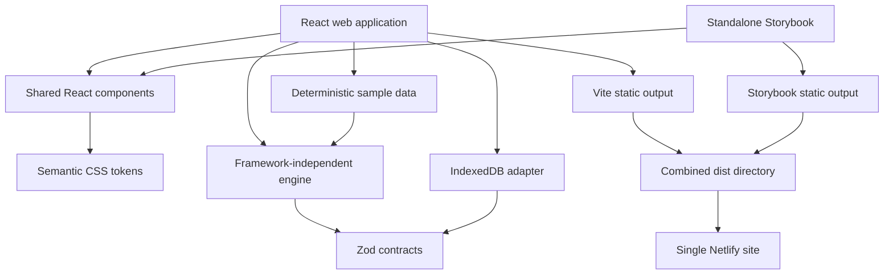

# Architecture

The graph is a directed acyclic graph with one trigger, one outgoing edge per ordinary node, two labelled edges per condition, and terminal End nodes. A run follows one active path. Joins can merge alternative paths; there is no parallel execution or loop support. The validator checks graph structure and configuration before execution. The same engine generates fixtures, interactive results, debugger traces, and benchmark results.

A `Simulation` owns lifecycle state and exposes `step()` and `cancel()`. `simulate()` runs synchronously for fixtures and benchmarks. `simulateAsync()` yields between nodes and cooperatively observes an AbortSignal. Every visited node produces input/output copies, virtual timestamps, logical duration, attempts, branch selection, and logs. Skipped nodes are marked after completion/failure. Cancellation preserves completed traces.

The browser context owns workflows and execution history. Editor history uses a pure reducer with a 50-snapshot limit; dragging creates one commit on release. Historical executions embed the workflow snapshot, so later edits cannot change debugger evidence. Persistence serializes debounced writes. Browser reload reads and validates schema v2; v1 is explicitly migrated. Failed storage attempts use localStorage and then in-memory state with visible export guidance.

Routes use lazy imports. XYFlow and Dagre are in a separate graph chunk. The landing preview uses shared node visuals and actual engine execution without mounting XYFlow. Storybook is separately buildable and published at the same origin under `/storybook/`.
